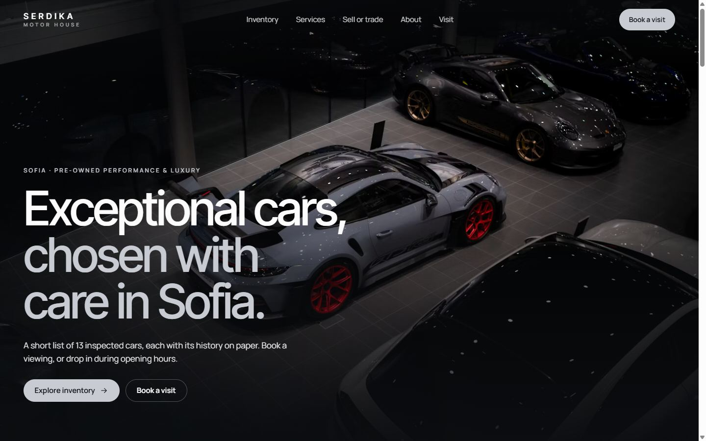
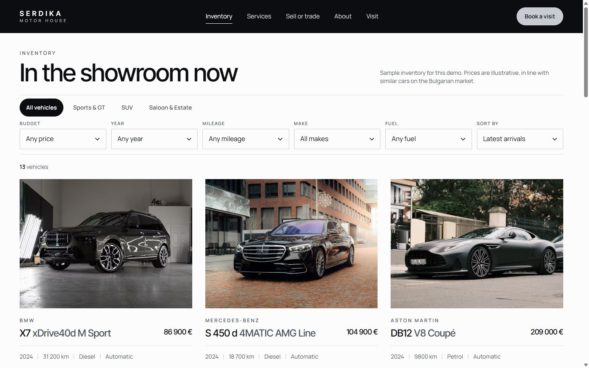
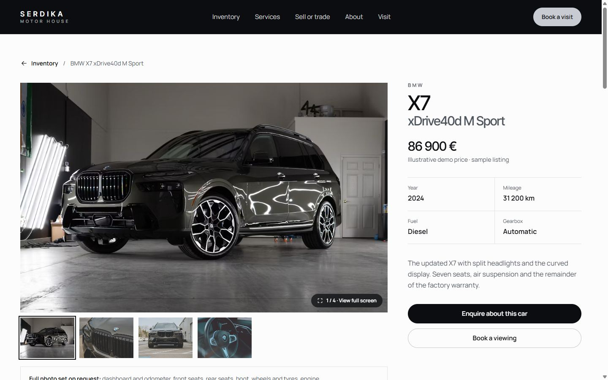
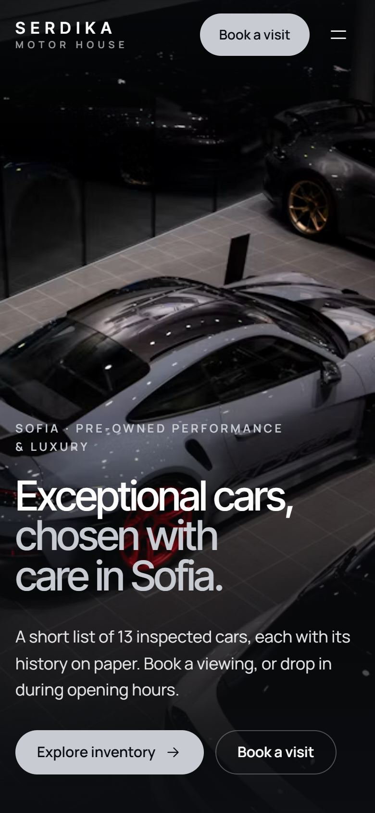
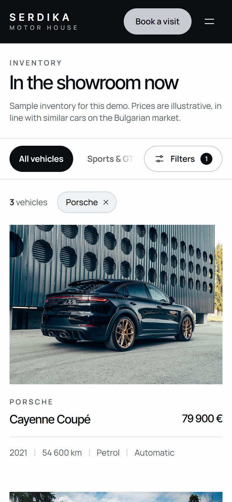
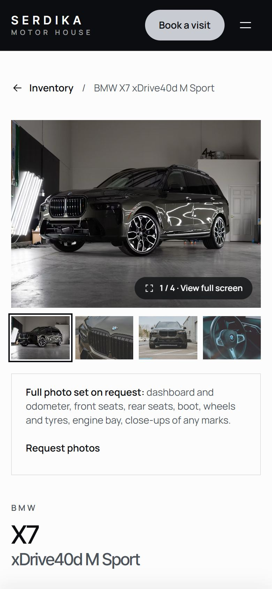

# Serdika Motor House: premium car dealership website (demo)

> **This is a portfolio demo for a fictional dealership.** Serdika Motor House does not exist. All vehicles,
> prices, inspection reports, services, hours and contact details are sample content, and **the forms do not
> send enquiries**: submitting one only shows a preview of what would have been sent.

**Live site:** https://serdika-motor-house.vercel.app

A responsive website for a curated pre-owned performance and luxury car dealership in Sofia, Bulgaria.
It covers the full buyer journey: browse and filter the inventory, open a car's detail page with a
full-screen gallery and an inspection report, then enquire, book a viewing or request a valuation.

| Home | Inventory | Vehicle |
|---|---|---|
|  |  |  |
|  |  |  |

## Features

**Inventory**
- 13 sample cars with prices set against comparable listings on the Bulgarian market (cars.bg, November 2026), shown in euros.
- Filters for budget, year, mileage, make, fuel and body type, plus sorting.
- Filters live in the URL, so a filtered list can be shared or bookmarked, for example
  [`/?page=inventory&make=BMW&price=100000`](https://serdika-motor-house.vercel.app/?page=inventory&make=BMW&price=100000).
- Active filters appear as removable chips; on phones the controls move into a bottom sheet.
- An empty result offers a "find me a car" request pre-filled from the chosen filters.

**Vehicle pages**
- Full-screen gallery with previous/next buttons, arrow keys, swipe, a photo counter and click-to-zoom.
  Portrait photos are shown as a landscape crop on wide screens, with a "Whole photo" toggle.
- Specification, features, and a sample inspection report with Passed/Noted labels, service history and warranty.
- "Comparable cars" ranked by price and intended use rather than body style alone.
- A compact enquiry panel (desktop) or bottom bar (phones) stays available while reading.

**Enquiries (demo only)**
- One accessible dialog handles viewing bookings, vehicle enquiries, photo requests, valuations
  (with optional photo upload) and "find me a car".
- Client-side validation with inline errors; nothing is sent or stored.

**Throughout**
- Separate pages for home, inventory, sell or trade, and each car, each with its own title and description.
- Back and Forward restore the scroll position you left.
- Animated FAQ accordion, scroll reveals and a hero entrance, all disabled under `prefers-reduced-motion`.

## Tech stack

| | |
|---|---|
| UI | React 18, TypeScript (strict) |
| Build | Vite 6 |
| Styling | Tailwind CSS 4 with design tokens in `src/index.css` |
| Routing | A small query-string router (`src/lib/router.ts`): works on any static host without rewrite rules |
| Images | Unsplash CDN, served as AVIF/WebP with responsive `srcset` and CDN-side cropping |
| Hosting | Vercel (static build) |

No UI framework, state library or router package: the only runtime dependencies are `react` and `react-dom`.

## Accessibility and performance

- Semantic landmarks, one `h1` per page, skip link, visible focus styles.
- Native `<dialog>` for the menu, filter sheet, gallery and forms: focus is trapped and Escape closes them.
- Form fields have labels, inline error messages linked with `aria-describedby`, and 16px text so iOS does not zoom.
- Buttons, links and form controls are at least 44px tall on phones; text colours meet WCAG AA contrast.
- The hero image is preloaded; other images load lazily with reserved space to avoid layout shift.

## Getting started

Requires Node.js 18 or newer.

```bash
npm install
npm run dev        # http://localhost:5183
npm run build      # type-check, then production build to dist/
npm run preview    # serve the production build
```

## Project structure

```
src/
  App.tsx                  page selection, scroll restoration
  lib/router.ts            query-string router, page titles, scroll memory
  lib/format.ts            EUR and km formatting (bg-BG)
  components/
    Header.tsx             fixed header and mobile menu
    Hero.tsx, Featured.tsx home page sections
    Sections.tsx           services, sell or trade, about, FAQ, visit, footer
    Inventory.tsx          filters, URL sync, chips, mobile filter sheet
    VehicleDetail.tsx      detail page, sticky enquiry, comparable cars
    Lightbox.tsx           full-screen gallery
    Inquiry.tsx            enquiry, booking, valuation and photo-request dialog
    Img.tsx                responsive Unsplash images
  data/
    site.ts                business name, contact, hours, navigation
    vehicles.ts            the 13 sample cars
    dossier.ts             generated sample inspection, service and warranty data
    content.ts             services, FAQ, sell-or-trade copy
```

| URL | Page |
|---|---|
| `/` | Home |
| `/?page=inventory` | Inventory (filters are added to the query string) |
| `/?page=sell` | Sell or trade |
| `/?vehicle=<slug>` | Vehicle detail |

## How it was built

I led this project and used Claude Code as an AI coding assistant to implement it. I defined the
product: a premium dealership for the Bulgarian market, its visual direction, the Serdika brand, pricing
based on current Bulgarian listings, and the feature set. I reviewed every iteration, ran external design
reviews, prioritised the fixes, and handled publishing to GitHub and Vercel.

## Making it real

To turn the demo into a working dealership site:

- Replace the sample cars, prices, inspection reports and photos with the dealership's own, shot in one
  consistent location and light.
- Connect the forms to a backend or form service in `onSubmit` in `src/components/Inquiry.tsx`, and add a privacy notice.
- Add the real business name, address, phone, email and opening hours in `src/data/site.ts`.
- Add `AutoDealer` and `Vehicle` structured data (JSON-LD) once the details are real; it is deliberately omitted
  while the content is fictional.

## Credits

- Photography from [Unsplash](https://unsplash.com), used under the [Unsplash License](https://unsplash.com/license).
  No photos are taken from marketplace listings. Car photos show the make and model they are labelled as,
  but not a specific car for sale.
- Fonts: Inter Tight and Manrope (Google Fonts, SIL Open Font License).
- Brand names and models are used only to describe the sample cars; this demo is not affiliated with any manufacturer.
